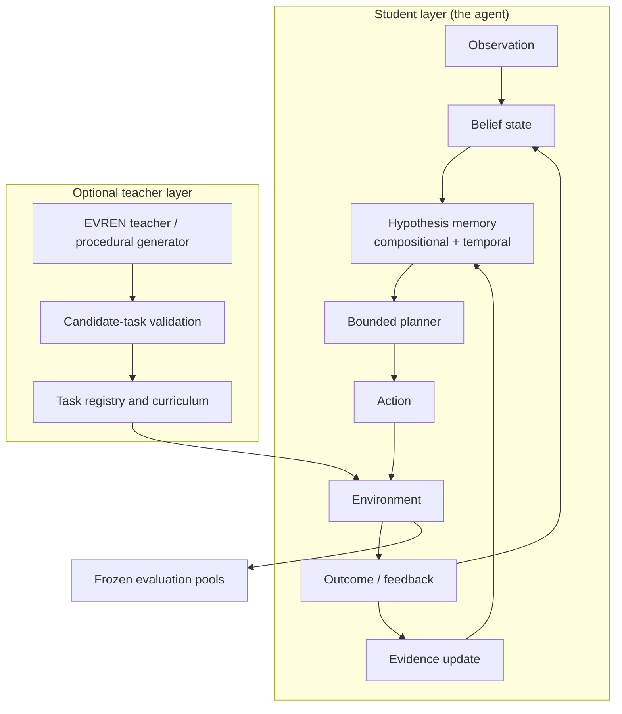

<div align="center">


# METARGON

**A crow-inspired research project investigating how compact agents learn hidden rules, remember evidence, form hypotheses, plan actions, and adapt when the world changes.**

[](#quick-start)
[](#architecture)
[](#contributing-and-license)

**[What it is](#what-metargon-is) · [How the agent works](#how-the-agent-works) · [Research status](#research-status) · [Results](#experimental-results) · [Architecture](#architecture) · [Quick start](#quick-start) · [Roadmap](#roadmap-and-limitations)**

</div>

---

## What METARGON is

METARGON is an **exploratory synthetic-research project**. It studies a single question, inspired by the famously adaptive crow:

> Can a small artificial agent discover what matters in an environment, test its beliefs through action, and revise its behavior when previously useful rules stop working?

The project answers with **bounded memory, explicit hypotheses, action planning, structured feedback, and falsifiable evaluations**. Everything is implemented from scratch — Python 3.11 (standard library only) and a Rust research kernel — with CPU-only, reproducible experiments.

METARGON is **not** a crow-brain simulation, a foundation model, or a demonstrated AGI system. It is a transparent laboratory for studying how resource-constrained agents learn and adapt.

## How the agent works

The agent is an **observe → learn → hypothesize → plan → act** loop:

1. **Observe** — a fixed public observation vector (agent position, objects, switches, plates, door readings). Hidden rule wiring is never exposed.
2. **Learn** — door events and nonevents update a **compositional hypothesis memory**: candidate conjunctive rules over public atoms are generated from *both* the pre-event and post-event context (dual-context generation, v0.12), verified, contradicted, and evicted under a hard cap (128 slots). Confirmed-event gating and certainty weighting (v0.11) make the learning stream noise-aware; evidence decays so stale rules do not dominate after a mechanism change.
3. **Hypothesize** — hypotheses are the agent's causal model of "what opens each door". Since v0.12 the agent also holds **temporal hypotheses** — *atom A becomes true, then atom B becomes true (within 30 steps) ⇒ door opens* — the first representational handle on order-dependent rules.
4. **Plan** — a bounded BFS planner converts beliefs and hypotheses into actions under strict expansion and evaluation budgets. When no plan exists, an information-gathering fallback keeps exploring; predicted/verified temporal hypotheses direct ordered probing (first atom, then second).
5. **Act and adapt** — outcomes feed back into the belief state and hypothesis memory, closing the loop. After a door opens, the atoms that held at opening can be briefly protected (recent-credit protection, since v0.12.1 **off by default**); the number of agreeing readings required to confirm an event adapts to the perceived noise level.

Two layers exist on top of the core agent:

- **Academy** — a reproducible continual-learning laboratory (student agents, procedural environments, frozen evaluation splits, checkpointing, a three-regime transfer protocol).
- **EVREN** — an optional LLM-backed *curriculum teacher* that proposes **tasks, never answers**. Proposals must pass leakage, schema, solvability, contamination, and duplicate checks before entering a training pool.

See [docs/ARCHITECTURE_OVERVIEW.md](docs/ARCHITECTURE_OVERVIEW.md) for the full implementation-level description.

## Research status

**Latest merged research version: METARGON v0.12.1** (regression recovery, PR #33) on top of **v0.12** (PR #29).

- **v0.9** showed the family-agnostic student clearly beats model-free baselines and transfers mechanism knowledge to held-out configurations, but could not close the gap to a family-knowing Bayesian planner.
- **v0.10** fixed measured pathologies and closed that gap — meeting or exceeding the Bayesian planner on most conditions while staying family-agnostic.
- **v0.11** made learning noise-aware, more than doubling noisy-observation success, at the cost of clean-condition regressions.
- **v0.12** added dual-context candidate generation, adaptive confirmation, short recent-credit protection, and the **temporal (ordered-sequence) hypothesis language**: exact D2 discovery on family F recovered to 76–89% (from 32–65% in v0.11) and temporal family-L exact-D1 discovery rose from **0.0% → 16.9–23.1%**, but F-noisy success regressed vs v0.11.
- **v0.12.1** turned recent-credit protection off by default: F-noisy success restored to v0.11's level (80.6%, Δ 0.00pp, CI [−3.1, +2.5]) while temporal L discovery and the D2 gains are preserved in the committed final runs. H-stable and R-stable trade-offs remain, reported honestly.
- **Academy Memory v0.5** separated transfer into **frozen (zero-shot) / adapt / continual** regimes: every trained variant scores *below* the untrained control in the frozen regime — retained persistent memory currently transfers nothing; all measured generalization is within-episode adaptation.
- **Independent audits v0.2/v0.3** corrected statistical sign errors in Academy memory reporting, hardened the hidden-configuration boundary, re-verified the v0.12 and Memory v0.4 report numbers against raw artifacts, and established frozen evaluation criteria.

Results are conditional on these environments and protocols; **no real-world robotics, AGI, or energy claims are made**.

## Research milestones

| Version | Scope | Status |
|---|---|---|
| CORVID v0.1–v0.7 | Early bounded-memory experiments (active perception → predictive world models) | Historical, preserved |
| METARGON v0.8 | Stateful five-position workshop; surprise-adaptive control | Completed, negative headline |
| METARGON v0.9 | Mechanism Lab: compositional causal memory + adaptive planner vs baselines | Completed, negative headline |
| Academy v0.1 + EVREN | Student/curriculum system + validated task-generation teacher | Completed, agent-reported |
| METARGON v0.10 | Robust perception, probe cooldowns, evidence decay, prioritized replay, structured-OOD transfer | Completed |
| EVREN curriculum v0.2 | Adaptive task selection, retention protocol, matched-budget curriculum experiment | Completed, null transfer |
| Academy Memory v0.3 | Hypothesis-memory audit; ablatable improvements; fresh-agent negative-transfer control | Completed |
| Independent generalization audit (v0.1) | Protocol audit + new families R (sustained-hold) and L (ordered-sequence) | Completed |
| Independent Audit v0.2 | Evaluation integrity: flipped memory-v0.3 signs corrected, hidden-config boundary, frozen protocols | Completed |
| Academy Memory v0.4 | Context-scoped evidence, memory-wipe control; `memory_wiped ≡ original` finding | Completed |
| Independent Audit v0.3 | Artifact re-verification of v0.12 + Memory v0.4; frozen criteria for v0.12.1/v0.5 | Completed |
| METARGON v0.12 | Dual-context candidates, adaptive confirmation, ordered-sequence temporal hypotheses | Completed |
| Academy Memory v0.5 | Three-regime transfer protocol + evidence bank; zero-shot transfer absent | Completed |
| METARGON v0.12.1 | Recent-credit protection off; F-noisy restored, temporal L preserved | **Latest merged** |

Full provenance and links: [docs/RESEARCH_INDEX.md](docs/RESEARCH_INDEX.md).

## Experimental results

All studies are paired (identical worlds per seed across policies), with bootstrap 95% CIs on per-seed deltas. **Percentages across versions are not directly comparable** — environments and protocols differ. The v0.12/v0.12.1 studies run at **4 seeds × 40 episodes** (vs 8 × 100 for v0.9–v0.11), so their CIs are wider and findings are directional, not definitive.

### v0.12.1 (latest merged, final runs: 4 seeds × 40 episodes)

Single adopted change vs v0.12: **recent-credit protection off** (default).

| Condition (family) | v0.10 | v0.11 | v0.12.1 | Bayes | v12.1 − v0.11 (pp) |
|---|---:|---:|---:|---:|---:|
| noisy_obs (F) | 44.4 | 80.6 | **80.6** | 76.2 | 0.00 [−3.1, +2.5] |
| stable (H) | 83.8 | 73.1 | 73.1 | 71.9 | 0.00 [0, 0] |
| stable (R) | 61.2 | 71.9 | 60.6 | 77.5 | −11.25 [−33.8, 0] |
| novel (R) | 80.0 | 84.4 | 79.4 | 84.4 | −5.00 [−15.0, 0] |
| stable (L) | 21.2 | 18.1 | **26.9** | 48.1 | +8.75 [−11.3, +40.0] |
| novel (L) | 21.9 | 19.4 | 25.0 | 42.5 | +5.62 [−3.8, +15.0] |

- **Positive:** the v0.12 F-noisy regression is closed (Δ 0.00 vs v0.11); family L success improves over v0.10/v0.11 with the temporal gain intact — exact D1 on L is **16.9% (stable) / 23.1% (novel)** for the temporal agent vs **0.0%** for v0.10/v0.11, whose unordered conjunctive hypotheses cannot express ordered rules (deltas vs the temporal-off ablation: +16.88 [0, 50.6] / +23.12 [0, 50.6]).
- **Negative (unresolved trade-offs):** H-stable stays −10.6pp vs v0.10 (shared v0.11 confirmed-event gating — closing it sacrifices D2 discovery); R-stable stays −11.3pp vs v0.11 (dual-context is the cause, but disabling it would sacrifice the F D2 recovery).
- **Consistency caveat:** success values and all L temporal values above are verified against the committed final-run artifacts (`results/v121/final_*.json`). The exact-D2 cells published in the v0.12.1 report come from diagnosis-phase runs and do not match the final-run artifacts under the same nominal settings (e.g. F-noisy D2 75.6 reported vs 45.0 in `final_f.json`; H-stable 70.0 reported vs 41.3 in `final_h.json`). This is documented as an open issue in [docs/DOC_CONSISTENCY_NOTES.md](docs/DOC_CONSISTENCY_NOTES.md) — no result was rewritten to reconcile it.

Final runs: `results/v121/final_{f,h,r,l}.json` · Report: [docs/RESEARCH_V121.md](docs/RESEARCH_V121.md).

### v0.12 study (4 seeds × 40 episodes, recent-credit on)

| Condition (family F) | v0.10 | v0.11 | v0.12 | Bayes | v12 − v11 (pp) |
|---|---:|---:|---:|---:|---:|
| stable | 85.62 | 85.62 | 85.62 | 78.75 | 0.00 |
| shift | 86.25 | 90.62 | **91.25** | 80.62 | +0.62 |
| noisy_obs | 44.38 | **80.62** | 72.50 | 76.25 | −8.12 [−24.4, +3.8] |
| novel | 91.25 | 91.88 | 91.25 | 79.38 | −0.63 |
| tight_budget | 73.12 | 90.00 | **90.62** | 65.62 | +0.63 |

- **Positive:** F-stable clean regression is gone (85.6%, at v0.10 level and above Bayes); **exact D2 discovery on F recovered to 76.9–88.8%** across all five conditions (v0.11: 31.9–66.9%) — dual-context generation restores D2 learning everywhere. On family H, exact D2 recovered to 70.0/76.9 (stable/novel) vs v0.11's 41.2/43.8. On family L, success 27.5/29.4 (vs v0.11 18.1/19.4) with temporal exact D1 **16.9/23.1%** vs 0.0%. Ablation: without temporal, L exact D1 = 0 — temporal memory is responsible for the entire L gain.
- **Negative:** F-noisy's −8.1pp vs v0.11 (CI includes 0) — v0.11 remains the strongest noisy variant in that study; H-stable −10.6pp and R-stable −11.3pp vs v0.10/v0.11 persist (diagnosed and honestly unresolved in v0.12.1).

Values verified against `results/v12/summary_{f,h,r,l}_small.json`. Report: [docs/RESEARCH_V12.md](docs/RESEARCH_V12.md) (numbers re-audited in [generalization_audit/docs/AUDIT_V03.md](generalization_audit/docs/AUDIT_V03.md)).

### v0.11 headline (8 seeds × 100 episodes, family F)

| Condition | v0.10 | v0.11 | Bayes | v11 − v10 (pp) | v11 − Bayes (pp) |
|---|---:|---:|---:|---:|---:|
| stable | 80.62 | 74.62 | 77.50 | −6.00 | −2.88 |
| shift | 86.88 | 86.25 | 80.62 | −0.63 | +5.62 |
| rapid_shift | 83.62 | 86.50 | 76.88 | +2.88 | +9.62 |
| iid | 67.75 | 68.25 | 79.00 | +0.50 | −10.75 |
| novel (held-out) | 89.75 | 86.75 | 78.50 | −3.00 | +8.25 |
| noisy_obs | 45.12 | **84.88** | 73.12 | **+39.75** | **+11.75** |
| tight_budget | 82.62 | 85.88 | 64.88 | +3.25 | +21.00 |

- **Positive:** noisy-observation success more than doubled (45.1% → 84.9%, +39.75pp, CI [25.1, 56.4]); v0.11 exceeds the privileged-family Bayesian planner under noise (+11.75pp) and beats it on 9 of 11 condition×family cells.
- **Negative (measured regressions):** clean-condition `stable` −6.0pp and structurally novel family H `stable` −11.9pp vs v0.10. The confirmed-event gating itself costs −6.75pp on H-stable. Certainty weighting is net-neutral-to-negative under noise (−1.75pp, CI includes 0). `iid` remains below Bayes (−10.75pp, CI [−19.8, −0.8]) because per-episode fresh configs favor the family-privileged prior. The invalid-action rate did not improve.
- **Ablations (noisy_obs):** confirmed events are the main driver (−cf costs 11.75pp); filtered replay helps (+4.37pp) over legacy replay; weighted replay < filtered.

Note: v0.11's noisy advantage motivated v0.12/v0.12.1. At the v0.12 study scale (4×40), none of the merged agents reaches this 84.9% noisy peak; v0.12.1 restores v0.11's 80.6%-level noisy success *at the 4×40 protocol*. Report: [docs/RESEARCH_V11.md](docs/RESEARCH_V11.md) · tables: `results/v11/benchmark_table_v11.md`.

### v0.10 (8 seeds × 100 episodes, family F)

v0.10 closed the gap to the Bayesian baseline that v0.9 could not: it met or exceeded Bayes on `stable` (80.75 vs 77.50), `shift` (89.25 vs 80.62), `rapid_shift`, `novel`, and `tight_budget`. Two documented negative results remain: `noisy_obs` still trails Bayes (−23.75pp, CI excludes 0 — the motivation for v0.11), and `iid` trails slightly (−4.5pp, CI includes 0). On the structurally novel family H — where the Bayesian model class is misspecified — v0.10 sustained ~80% success on both conditions while Bayes dropped to ~67%; CIs are wide at 8 seeds, so this is reported as a **directional transfer result**, not a definitive win. Report: [docs/RESEARCH_V10.md](docs/RESEARCH_V10.md).

### v0.9 (8 paired seeds, 7 conditions)

METARGON clearly beats model-free baselines (random/episodic/Q-learning ~0–1%) and transfers mechanism knowledge to held-out configurations, **but does not outperform the family-knowing Bayesian planner** (e.g. stable 35.1% vs Bayes 77.5%). A negative result for closing the gap via hypothesis composition alone. Report: [docs/RESEARCH_V09.md](docs/RESEARCH_V09.md).

### Independent generalization audit (families R and L)

An independent audit tested the unmodified v0.10 student on two **structurally novel** rule families:

- **Family R (sustained-hold):** a door opens only after its condition holds for 3 consecutive states. The student transfers its causal machinery to this never-seen axis (50–77% success vs ~0–3% for model-free baselines), but still does not beat the family-F Bayesian planner on any condition (−13 to −33pp). Exact-rule discovery 50–93%; false-verified hypotheses remain high (up to ~4.6/episode).
- **Family L (ordered-sequence):** a door opens only when two atoms become true in a specific order. The v0.10 student's unordered conjunctive hypothesis language **cannot express the rule**: exact D1 discovery is 0.0% on every condition, and success (~23–58%) is purely behavioral. This representational ceiling is the specific target v0.12's temporal hypotheses later addressed (see the v0.12/v0.12.1 results above).
- Compute matching matters: at a per-decision expansion cap of 120, the student loses 20–50pp on R.

Samples are small (R: 2×15; L: 3×20); findings are directional. Audit: [generalization_audit/docs/AUDIT_REPORT.md](generalization_audit/docs/AUDIT_REPORT.md).

### Academy research (development layer, separate protocols)

- **Academy v0.1:** student vs baselines on frozen val/test/OOD pools. METARGON held-out test 50.0% vs Bayes 27.5% (but val 66.7% vs 50.4% — pool-dependent); OOD 50.0% vs 20.8% (Bayes is structurally mismatched on OOD). Replay is neutral (identical with/without). Report: [docs/ACADEMY_RESEARCH_V01.md](docs/ACADEMY_RESEARCH_V01.md).
- **EVREN curriculum v0.2:** adaptive learning-progress selection demonstrably ran and improved training-phase success (0.444 vs 0.419), but produced **no measurable transfer benefit** — LP and teacher-source effects are exactly +0.0000 (zero-width CI). Retention is flat. The student's hypothesis-memory saturation is the binding constraint, not the curriculum source. Report: [docs/EVREN_CURRICULUM_V02.md](docs/EVREN_CURRICULUM_V02.md).
- **Academy Memory v0.3:** an untrained fresh student scores **0.695** on the classic grid vs 0.562 for every trained variant — training itself causes negative transfer (≈0.13 success). Adaptive probing improves training-phase success (+0.144) without hurting transfer (bit-identical classic vectors); ratio-gated contradictions, evidence windowing, and the combined variant are directionally negative. Memory v0.3's comparison table originally had flipped delta signs — corrected and re-verified against the raw artifact by the Independent Audit v0.2. Report: [docs/MEMORY_V03.md](docs/MEMORY_V03.md).
- **Academy Memory v0.4:** context-scoped evidence handling (per-context support/contradiction, reversible confidence, conservative transfer gating) plus a decisive control: **`memory_wiped ≡ original`** — deleting all learned memory leaves held-out scores bit-identical. Independent audit v0.3 re-verified the report numbers vs raw artifacts and corrected flipped delta signs. Report: [docs/MEMORY_V04.md](docs/MEMORY_V04.md).
- **Academy Memory v0.5 — three-regime transfer protocol:** a `frozen_policy` switch separates (1) **frozen zero-shot** (learning disabled during evaluation — measures what retained memory alone transfers), (2) **adapt** (within-episode learning, the v0.4 protocol), and (3) **continual** (post-training probing). Result: **zero-shot transfer is absent** — every trained variant scores *below* the fresh control in the frozen regime (0.250–0.281 vs 0.312); the gap between adapt and frozen regimes is ≈0.31–0.38 for every variant, so all measured generalization comes from within-episode adaptation. A new **evidence bank** (bounded verified-evidence reuse for probing) demonstrably runs (79,345 retrievals) yet does not beat the control in any regime; no variant beats the untrained control, and retention is flat. Report: [docs/MEMORY_V05.md](docs/MEMORY_V05.md) (sign-convention caveat: [docs/DOC_CONSISTENCY_NOTES.md](docs/DOC_CONSISTENCY_NOTES.md)).
- **Independent audits v0.2/v0.3:** statistical/sign-reporting fixes (memory v0.3, v0.4), hidden-configuration boundary hardening, missing-checkpoint fallback fix, artifact-verified re-checking of the v0.12 report, seed-sensitivity analysis of the temporal L result (see below), and frozen evaluation criteria for v0.12.1/Memory v0.5. Reports: [generalization_audit/docs/AUDIT_V02.md](generalization_audit/docs/AUDIT_V02.md), [generalization_audit/docs/AUDIT_V03.md](generalization_audit/docs/AUDIT_V03.md).

### Student agents vs comparators vs oracles

- **Student agents** (METARGON v0.9–v0.12.1, Academy student) learn from **public observations only**; the hidden wiring is never exposed.
- **Bayesian comparators** are deliberately privileged: they receive the *declared generative family* (a correct model class on F) and run a particle-filter planner. On family H (and R/L) that declared class is misspecified, so Bayes is a strong, not a fair, baseline.
- **Oracles** have perfect knowledge of hidden rules and are **diagnostic only — excluded from all rankings**.
- **Model-free baselines** (random, episodic, Q-learning) anchor the lower bound and are consistently at or near chance on compositional tasks.

## Architecture



**Two distinct layers:** the student acts and learns from environment feedback; the optional teacher proposes *tasks*, not privileged answers. Generated tasks must pass validation, solvability, duplicate checks, and evaluation-contamination safeguards before they can enter training.

## Quick start

Requires **Python 3.11+** (standard library only — no pip dependencies) and, for the Rust kernels, `cargo +1.88.0`. Run commands from the repository root.

```bash
# full Python test suite (historical + v0.9–v0.12.x; expect 188 tests)
python -m unittest discover -s python -v

# repository hygiene (merge markers, Markdown links, Python compile)
python scripts/check_repo.py

# latest benchmark harness (v0.12/v0.12.1 policy set; episodes >= 4)
python python/benchmark_v12.py --seeds 4 --episodes 40 --family f \
    --conditions stable,noisy_obs --parallel --workers 6 \
    --json results/v12/summary_repro.json
python python/v12_postprocess.py results/v12/summary_repro.json

# Academy CLI (smoke test)
python -m academy.cli.main smoke

# Academy tests
python -m unittest discover -s academy/tests

# Academy Memory v0.5 three-regime experiment (offline; pin the hash seed)
python -m unittest academy.tests.test_memory_v05
PYTHONHASHSEED=0 python academy/tools/memory_experiment_v05.py

# Rust research kernel
cd rust && cargo +1.88.0 test && cd ..

# Independent generalization audit tests
python -m unittest discover -s generalization_audit/tests -t . -v
```

For the full set of verified, version-specific commands (all benchmarks, ablations, memory experiments, EVREN experiments, audit reproduction), see [docs/GETTING_STARTED.md](docs/GETTING_STARTED.md) and [docs/BENCHMARK_GUIDE.md](docs/BENCHMARK_GUIDE.md).

## Documentation index

| Guide | Purpose |
|---|---|
| [docs/GETTING_STARTED.md](docs/GETTING_STARTED.md) | Installation, prerequisites, first commands, CLI reference |
| [docs/ARCHITECTURE_OVERVIEW.md](docs/ARCHITECTURE_OVERVIEW.md) | How the agent, memory, planner, Academy, and EVREN work |
| [docs/RESEARCH_INDEX.md](docs/RESEARCH_INDEX.md) | All research reports, milestones, versions, and findings |
| [docs/BENCHMARK_GUIDE.md](docs/BENCHMARK_GUIDE.md) | Reproducing every benchmark, ablation, and test suite |
| [docs/RESEARCH_PROTOCOL.md](docs/RESEARCH_PROTOCOL.md) | Research principles: pairing, baselines, pre-registration, honesty |
| [docs/DOC_CONSISTENCY_NOTES.md](docs/DOC_CONSISTENCY_NOTES.md) | Open documentation-consistency issues recorded during the documentation sync |

## Roadmap and limitations

**Roadmap (merged work and next gates):**

- [x] Preserve CORVID history and rename to METARGON (v0.8)
- [x] v0.9 Mechanism Lab + negative Bayesian-gap result
- [x] v0.10 robust perception/evidence decay/structured-OOD transfer
- [x] v0.11 noise-aware learning
- [x] Academy v0.1, EVREN integration, curriculum v0.2, memory v0.3
- [x] Independent generalization audit (families R/L)
- [x] Independent audits v0.2/v0.3: sign corrections, evaluation-integrity fixes, frozen protocols
- [x] Academy Memory v0.4/v0.5: context-scoped evidence, three-regime transfer protocol, evidence bank
- [x] v0.12: dual-context candidates, adaptive confirmation, temporal (ordered) hypotheses
- [x] v0.12.1: recent-credit off by default — F-noisy restored, temporal L preserved (latest merged)
- [ ] Close the remaining trade-offs: H-stable and R-stable regressions, the `iid` gap to Bayes
- [ ] Lift temporal family-L discovery beyond the seed-sensitive preliminary estimate (one seed dominates)
- [ ] Achieve positive zero-shot (frozen) Academy transfer — currently absent
- [ ] Resolve the open cross-artifact consistency issues ([docs/DOC_CONSISTENCY_NOTES.md](docs/DOC_CONSISTENCY_NOTES.md))
- [ ] Independently verify Academy results at larger scale
- [ ] Measure real hardware latency, memory, and energy before making efficiency claims

**Known limitations:**

- All results are on synthetic 7×5 grid environments with hidden conjunctive- and sequence-style rules; generalization to real-world settings is unmeasured.
- Family-agnostic learning is intentionally sample-inefficient relative to family-knowing Bayesian priors on `iid` conditions.
- v0.12/v0.12.1 evidence is **directional only**: 4 seeds × 40 episodes, wide CIs; the 8×100 runs used for v0.9–v0.11 were not feasible for the slower v0.12 configurations in the available time budget.
- Temporal family-L exact discovery is **seed-sensitive**: the stable-condition result is driven almost entirely by one of the four seeds (audit v0.3 §5); verified temporal hypotheses remain rare (≈0.75 per seed-run), with discovery leaning on predicted hypotheses and probing.
- H-stable and R-stable regressions persist, with documented mechanism trade-offs (confirmed-event gating, dual-context candidates); the short recent-credit protection shipped in v0.12 is **off by default** since v0.12.1, and `dual_if_changed`/anomaly-gated-confirmation prototypes were measured and rejected.
- Exact-D2 claims in the v0.12.1 report rest on diagnosis-phase runs whose numbers conflict with the final-run artifacts (open issue, see [docs/DOC_CONSISTENCY_NOTES.md](docs/DOC_CONSISTENCY_NOTES.md)).
- Academy results are audited but not independently re-run at full scale; retained persistent memory produces no measurable zero-shot transfer, and the untrained fresh control still leads in the frozen regime.

## Contributing and license

Contributions — code, experiments, documentation, or careful peer review — are welcome. Please read [CONTRIBUTING.md](CONTRIBUTING.md): it covers the standard-library-only rule, the `#![forbid(unsafe_code)]` Rust kernel, matched-seed experiment discipline, pre-registration, and the project's scientific-integrity requirements (including the mandate to preserve raw results and publish negative findings).

**License:** MIT — see [LICENSE](LICENSE).

---

<div align="center">

**Make a hypothesis. Test it. Learn from the outcome.**

*METARGON — Learning a changing world.*

</div>
