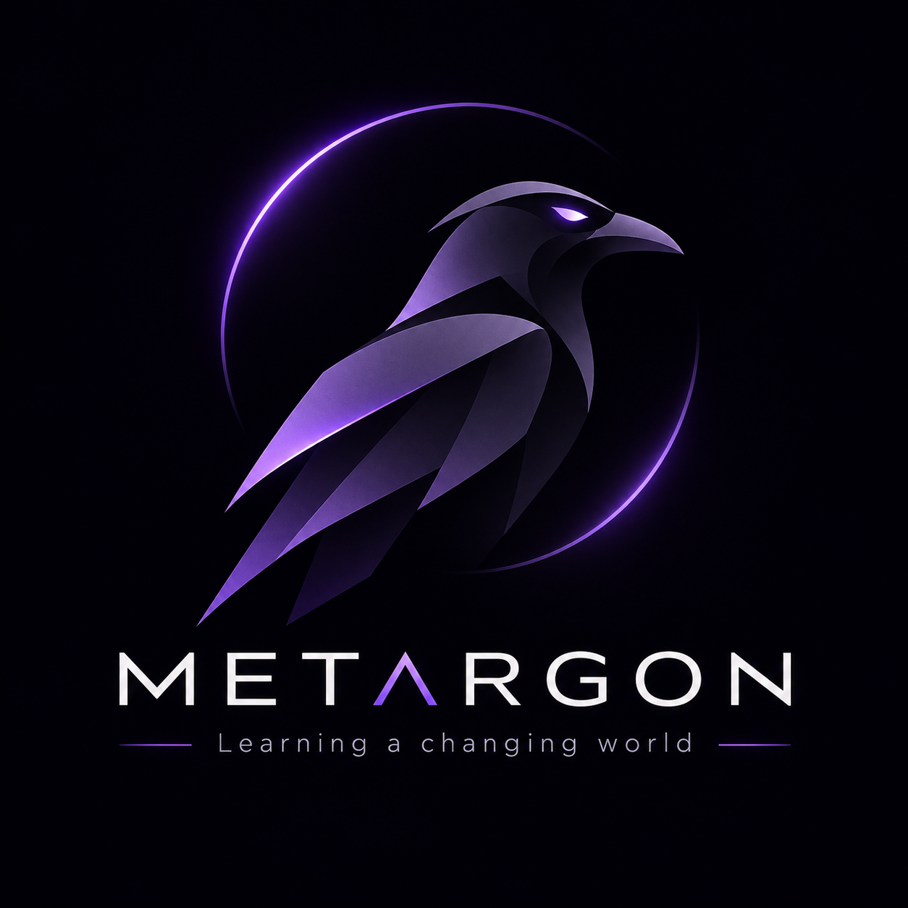
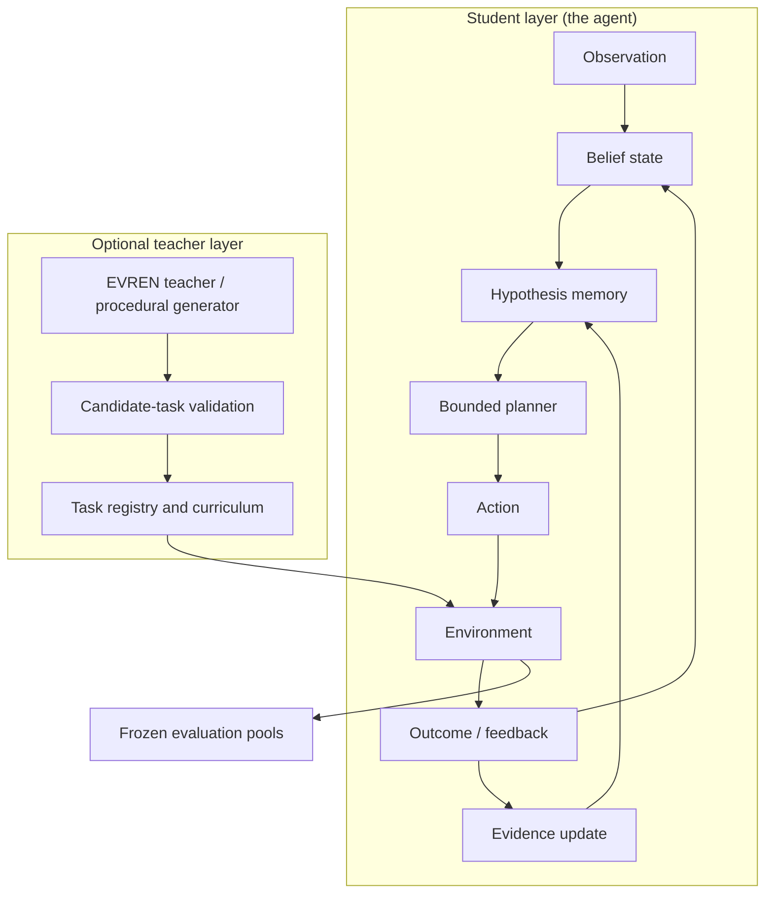

<div align="center">




# METARGON

**A crow-inspired research project investigating how compact agents learn hidden rules, remember evidence, form hypotheses, plan actions, and adapt when the world changes.**

[](#quick-start)
[](#architecture)
[](#contributing-and-license)

**[What it is](#what-metargon-is) · [How the agent works](#how-the-agent-works) · [Research status](#research-status) · [Results](#experimental-results) · [Architecture](#architecture) · [Quick start](#quick-start) · [Roadmap](#roadmap-and-limitations)**

</div>

---

## What METARGON is

METARGON is an **exploratory synthetic-research project**. It studies a single question, inspired by the famously adaptive crow:

> Can a small artificial agent discover what matters in an environment, test its beliefs through action, and revise its behavior when previously useful rules stop working?

The project answers with **bounded memory, explicit hypotheses, action planning, structured feedback, and falsifiable evaluations**. Everything is implemented from scratch — Python 3.11 (standard library only) and a Rust research kernel — with CPU-only, reproducible experiments.

METARGON is **not** a crow-brain simulation, a foundation model, or a demonstrated AGI system. It is a transparent laboratory for studying how resource-constrained agents learn and adapt.

## How the agent works

The agent is an **observe → learn → hypothesize → plan → act** loop:

1. **Observe** — a fixed public observation vector (agent position, objects, switches, plates, door readings). Hidden rule wiring is never exposed.
2. **Learn** — door events and nonevents update a **compositional hypothesis memory**: candidate conjunctive rules over public atoms are generated, verified, contradicted, and evicted under a hard cap (128 slots). Evidence decays over time so stale rules do not dominate after a mechanism change.
3. **Hypothesize** — hypotheses are the agent's causal model of "what opens each door". Verified hypotheses drive probing and protection; contradicted ones are recycled or replaced.
4. **Plan** — a bounded BFS planner converts beliefs and hypotheses into actions under strict expansion and evaluation budgets. When no plan exists, an information-gathering fallback keeps exploring.
5. **Act and adapt** — outcomes feed back into the belief state and hypothesis memory, closing the loop.

Two layers exist on top of the core agent:

- **Academy** — a reproducible continual-learning laboratory (student agents, procedural environments, frozen evaluation splits, checkpointing).
- **EVREN** — an optional LLM-backed *curriculum teacher* that proposes **tasks, never answers**. Proposals must pass leakage, schema, solvability, contamination, and duplicate checks before entering a training pool.

See [docs/ARCHITECTURE_OVERVIEW.md](docs/ARCHITECTURE_OVERVIEW.md) for the full implementation-level description.

## Research status

**Latest merged research version: METARGON v0.11 (noise-aware learning).**

The project has run controlled paired studies across seven conditions (stable, shift, rapid_shift, iid, novel, noisy_obs, tight_budget) plus a structurally novel family `H`, an independent generalization audit, and an Academy curriculum program. Results are conditional on these environments and protocols; **no real-world robotics, AGI, or energy claims are made**.

The headline story so far:

- **v0.9** showed the family-agnostic student clearly beats model-free baselines (random/episodic/Q-learning) and transfers mechanism knowledge to held-out configurations, but could not close the gap to a family-knowing Bayesian planner.
- **v0.10** fixed measured pathologies (discovery freeze, contradictory protected atoms, raw-noise belief corruption, candidate truncation, stale evidence) and closed the gap — meeting or exceeding the Bayesian planner on most conditions while staying family-agnostic.
- **v0.11** made learning noise-aware (confirmed events, certainty-weighted evidence, filtered replay). It more than doubled noisy-observation success and now exceeds the Bayesian planner there, at the cost of small clean-condition regressions, reported honestly below.
- **Academy + EVREN curriculum research** found that curriculum ordering and teacher-augmented task pools do not (yet) measurably improve held-out transfer — the student's hypothesis-memory saturation is the binding constraint. Academy Memory v0.3 quantified **negative transfer**: training itself costs ~0.13 success on unseen configs.

## Research milestones

| Version | Scope | Status |
|---|---|---|
| CORVID v0.1–v0.7 | Early bounded-memory experiments (active perception → predictive world models) | Historical, preserved |
| METARGON v0.8 | Stateful five-position workshop; surprise-adaptive control | Completed, negative headline |
| METARGON v0.9 | Mechanism Lab: compositional causal memory + adaptive planner vs baselines | Completed, negative headline |
| Academy v0.1 + EVREN | Student/curriculum system + validated task-generation teacher | Completed, agent-reported |
| METARGON v0.10 | Robust perception, probe cooldowns, evidence decay, prioritized replay, structured-OOD transfer | Completed |
| EVREN curriculum v0.2 | Adaptive task selection, retention protocol, matched-budget curriculum experiment | Completed, null transfer |
| Academy Memory v0.3 | Hypothesis-memory audit; ablatable improvements; fresh-agent negative-transfer control | Completed |
| Independent generalization audit | Protocol audit + new families R (sustained-hold) and L (ordered-sequence) | Completed |
| METARGON v0.11 | Noise-aware learning: confirmed events, certainty-weighted evidence, replay filtering | **Latest merged** |

Full provenance and links: [docs/RESEARCH_INDEX.md](docs/RESEARCH_INDEX.md).

## Experimental results

All studies are paired (identical worlds per seed across policies), with bootstrap 95% CIs on per-seed deltas. **Percentages across versions are not directly comparable** — environments and protocols differ.

### v0.11 headline (8 seeds × 100 episodes, family F)

| Condition | v0.10 | v0.11 | Bayes | v11 − v10 (pp) | v11 − Bayes (pp) |
|---|---:|---:|---:|---:|---:|
| stable | 80.62 | 74.62 | 77.50 | −6.00 | −2.88 |
| shift | 86.88 | 86.25 | 80.62 | −0.63 | +5.62 |
| rapid_shift | 83.62 | 86.50 | 76.88 | +2.88 | +9.62 |
| iid | 67.75 | 68.25 | 79.00 | +0.50 | −10.75 |
| novel (held-out) | 89.75 | 86.75 | 78.50 | −3.00 | +8.25 |
| noisy_obs | 45.12 | **84.88** | 73.12 | **+39.75** | **+11.75** |
| tight_budget | 82.62 | 85.88 | 64.88 | +3.25 | +21.00 |

- **Positive:** noisy-observation success more than doubled (45.1% → 84.9%, +39.75pp, CI [25.1, 56.4]); v0.11 exceeds the privileged-family Bayesian planner under noise (+11.75pp) and beats it on 9 of 11 condition×family cells.
- **Negative (measured regressions):** clean-condition `stable` −6.0pp and structurally novel family H `stable` −11.9pp vs v0.10. The confirmed-event gating itself costs −6.75pp on H-stable. Certainty weighting is net-neutral-to-negative under noise (−1.75pp, CI includes 0). `iid` remains below Bayes (−10.75pp, CI [−19.8, −0.8]) because per-episode fresh configs favor the family-privileged prior. The invalid-action rate did not improve.
- **Ablations (noisy_obs):** confirmed events are the main driver (−cf costs 11.75pp); filtered replay helps (+4.37pp) over legacy replay; weighted replay < filtered.

Report: [docs/RESEARCH_V11.md](docs/RESEARCH_V11.md) · tables: `results/v11/benchmark_table_v11.md`.

### v0.10 (8 seeds × 100 episodes, family F)

v0.10 closed the gap to the Bayesian baseline that v0.9 could not: it met or exceeded Bayes on `stable` (80.75 vs 77.50), `shift` (89.25 vs 80.62), `rapid_shift`, `novel`, and `tight_budget`. Two documented negative results remain: `noisy_obs` still trails Bayes (−23.75pp, CI excludes 0 — the motivation for v0.11), and `iid` trails slightly (−4.5pp, CI includes 0). On the structurally novel family H — where the Bayesian model class is misspecified — v0.10 sustained ~80% success on both conditions while Bayes dropped to ~67%; CIs are wide at 8 seeds, so this is reported as a **directional transfer result**, not a definitive win. Prioritized replay was functionally validated but empirically neutral-to-negative (−4.7pp under noise). Report: [docs/RESEARCH_V10.md](docs/RESEARCH_V10.md).

### v0.9 (8 paired seeds, 7 conditions)

METARGON clearly beats model-free baselines (random/episodic/Q-learning ~0–1%) and transfers mechanism knowledge to held-out configurations, **but does not outperform the family-knowing Bayesian planner** (e.g. stable 35.1% vs Bayes 77.5%). A negative result for closing the gap via hypothesis composition alone. Report: [docs/RESEARCH_V09.md](docs/RESEARCH_V09.md).

### Independent generalization audit (families R and L)

An independent audit tested the unmodified v0.10 student on two **structurally novel** rule families:

- **Family R (sustained-hold):** a door opens only after its condition holds for 3 consecutive states. The student transfers its causal machinery to this never-seen axis (50–77% success vs ~0–3% for model-free baselines), but still does not beat the family-F Bayesian planner on any condition (−13 to −33pp). Exact-rule discovery 50–93%; false-verified hypotheses remain high (up to ~4.6/episode).
- **Family L (ordered-sequence):** a door opens only when two atoms become true in a specific order. The student's unordered conjunctive hypothesis language **cannot express the rule**: exact D1 discovery is 0.0% on every condition, and success (~23–58%) is purely behavioral. This is a clean negative result on representational capacity.
- Compute matching matters: at a per-decision expansion cap of 120, the student loses 20–50pp on R.

Samples are small (R: 2×15; L: 3×20); findings are directional. Audit: [generalization_audit/docs/AUDIT_REPORT.md](generalization_audit/docs/AUDIT_REPORT.md).

### Academy research (development layer, separate protocols)

- **Academy v0.1:** student vs baselines on frozen val/test/OOD pools. METARGON held-out test 50.0% vs Bayes 27.5% (but val 66.7% vs 50.4% — pool-dependent); OOD 50.0% vs 20.8% (Bayes is structurally mismatched on OOD). Replay is neutral (identical with/without). Report: [docs/ACADEMY_RESEARCH_V01.md](docs/ACADEMY_RESEARCH_V01.md).
- **EVREN curriculum v0.2:** adaptive learning-progress selection demonstrably ran and improved training-phase success (0.444 vs 0.419), but produced **no measurable transfer benefit** — LP and teacher-source effects are exactly +0.0000 (zero-width CI). Retention is flat. The student's saturated hypothesis memory is the binding constraint, not the curriculum source. Report: [docs/EVREN_CURRICULUM_V02.md](docs/EVREN_CURRICULUM_V02.md).
- **Academy Memory v0.3:** an untrained fresh student scores **0.695** on the classic grid vs 0.562 for every trained variant — training itself causes negative transfer. Adaptive probing improves training-phase success (+0.144) without hurting transfer (bit-identical classic vectors); ratio-gated contradictions, evidence windowing, and the combined variant are directionally negative. Report: [docs/MEMORY_V03.md](docs/MEMORY_V03.md).

### Student agents vs comparators vs oracles

- **Student agents** (METARGON v0.9–v0.11, Academy student) learn from **public observations only**; the hidden wiring is never exposed.
- **Bayesian comparators** are deliberately privileged: they receive the *declared generative family* (a correct model class on F) and run a particle-filter planner. On family H (and R/L) that declared class is misspecified, so Bayes is a strong, not a fair, baseline.
- **Oracles** have perfect knowledge of hidden rules and are **diagnostic only — excluded from all rankings**.
- **Model-free baselines** (random, episodic, Q-learning) anchor the lower bound and are consistently at or near chance on compositional tasks.

## Architecture



**Two distinct layers:** the student acts and learns from environment feedback; the optional teacher proposes *tasks*, not privileged answers. Generated tasks must pass validation, solvability, duplicate checks, and evaluation-contamination safeguards before they can enter training.

## Quick start

Requires **Python 3.11+** (standard library only — no pip dependencies) and, for the Rust kernels, `cargo +1.88.0`. Run commands from the repository root.

```bash
# full Python test suite (historical + v0.9–v0.11)
python -m unittest discover -s python -v

# repository hygiene (merge markers, Markdown links, Python compile)
python scripts/check_repo.py

# v0.11 benchmark (8 seeds × 100 episodes), results to results/v11/
python python/benchmark_v11.py --seeds 8 --episodes 100 --parallel \
    --workers 6 --no-mem --json results/v11/summary.json
python python/v11_postprocess.py

# Academy CLI (smoke test)
python -m academy.cli.main smoke

# Academy tests
python -m unittest discover -s academy/tests

# Rust research kernel
cd rust && cargo +1.88.0 test && cd ..

# Independent generalization audit tests
python -m unittest discover -s generalization_audit/tests -t . -v
```

For the full set of verified, version-specific commands (benchmarks, ablation runs, attributes, EVREN experiments, audit reproduction), see [docs/GETTING_STARTED.md](docs/GETTING_STARTED.md) and [docs/BENCHMARK_GUIDE.md](docs/BENCHMARK_GUIDE.md).

## Documentation index

| Guide | Purpose |
|---|---|
| [docs/GETTING_STARTED.md](docs/GETTING_STARTED.md) | Installation, prerequisites, first commands, CLI reference |
| [docs/ARCHITECTURE_OVERVIEW.md](docs/ARCHITECTURE_OVERVIEW.md) | How the agent, memory, planner, Academy, and EVREN work |
| [docs/RESEARCH_INDEX.md](docs/RESEARCH_INDEX.md) | All research reports, milestones, versions, and findings |
| [docs/BENCHMARK_GUIDE.md](docs/BENCHMARK_GUIDE.md) | Reproducing every benchmark, ablation, and test suite |
| [docs/RESEARCH_PROTOCOL.md](docs/RESEARCH_PROTOCOL.md) | Research principles: pairing, baselines, pre-registration, honesty |

## Roadmap and limitations

**Roadmap (merged work and next gates):**

- [x] Preserve CORVID history and rename to METARGON (v0.8)
- [x] v0.9 Mechanism Lab + negative Bayesian-gap result
- [x] v0.10 robust perception/evidence decay/structured-OOD transfer
- [x] v0.11 noise-aware learning (latest merged version)
- [x] Academy v0.1, EVREN integration, curriculum v0.2, memory v0.3
- [x] Independent generalization audit (families R/L)
- [ ] Reduce or eliminate the clean-condition regression in v0.11
- [ ] Extend the hypothesis language beyond unordered conjunctive sets (family L)
- [ ] Improve noisy-condition robustness without sacrificing clean-condition performance
- [ ] Measure real hardware latency, memory, and energy before making efficiency claims
- [ ] Independently verify Academy results at larger scale

Active development branches (not merged, **not part of this documentation**): `research/v12-general-causality` (v0.12), `academy/memory-v04` (Academy Memory v0.4), and follow-up audit work. Do not cite unmerged features as completed.

**Known limitations:**

- All results are on synthetic 7×5 grid environments with hidden conjunctive-style rules; generalization to real-world settings is unmeasured.
- Family-agnostic learning is intentionally sample-inefficient relative to family-knowing Bayesian priors on `iid` conditions.
- The hypothesis language cannot express order-dependent rules (family L).
- Noise robustness trades off against clean-condition performance in v0.11.
- Academy results are agent-reported/audited but not yet independently re-run at full scale in this repository.

## Contributing and license

Contributions — code, experiments, documentation, or careful peer review — are welcome. Please read [CONTRIBUTING.md](CONTRIBUTING.md): it covers the standard-library-only rule, the `#![forbid(unsafe_code)]` Rust kernel, matched-seed experiment discipline, pre-registration, and the project's scientific-integrity requirements (including the mandate to preserve raw results and publish negative findings).

**License:** MIT — see [LICENSE](LICENSE).

---

<div align="center">

**Make a hypothesis. Test it. Learn from the outcome.**

*METARGON — Learning a changing world.*

</div>
