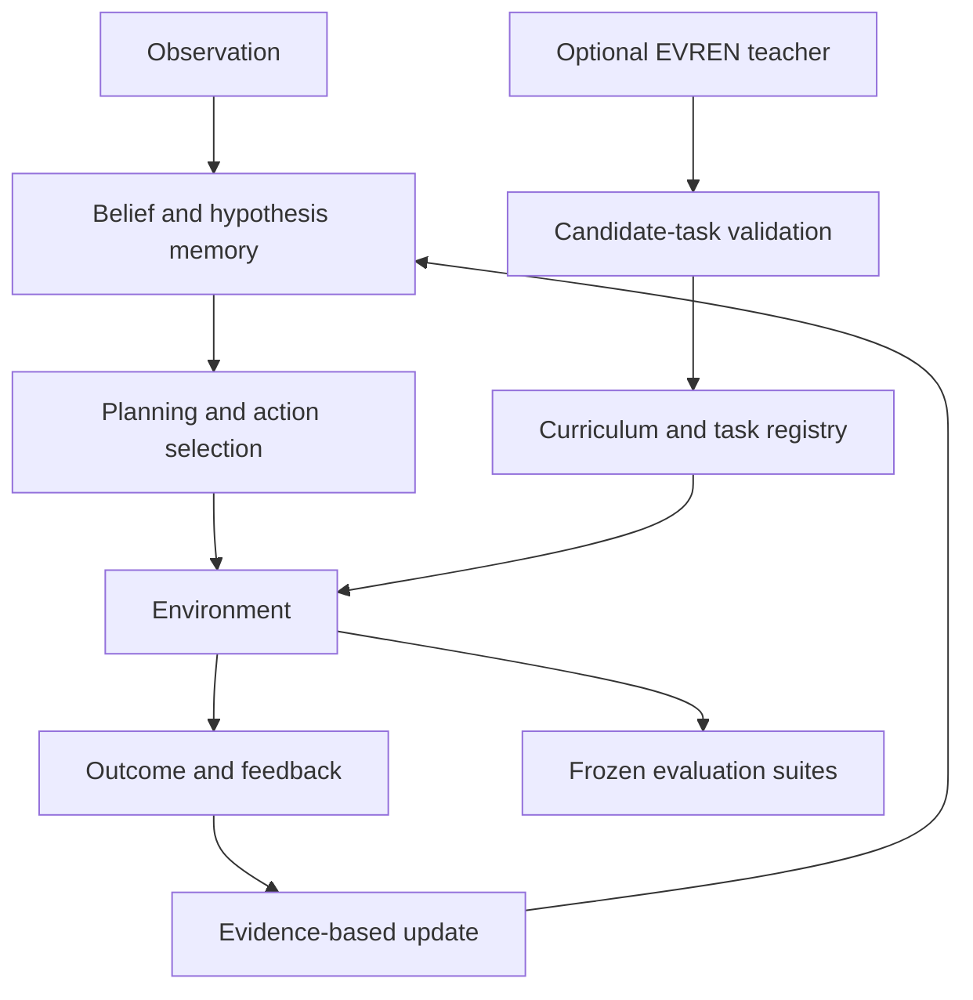

<div align="center">


# 🐦‍⬛ METARGON

### Learning a changing world.

**A crow-inspired research project exploring how compact agents learn hidden rules, remember evidence, plan actions, and adapt when the environment changes.**

<p align="center">
  
</p>

[](#research-status)
[](#quick-start)
[](#architecture)
[](#license)
[](#research-principles)

**[Overview](#why-metargon) · [Architecture](#architecture) · [Experiments](#experimental-results) · [Quick start](#quick-start) · [Roadmap](#research-roadmap)**

</div>

---

## Why METARGON?

> **Intelligence is not just predicting a result. It is adapting when the world changes.**

Crows inspired the question, not the implementation: **Can a small artificial agent discover what matters, test hypotheses through action, and revise its behavior when previously useful rules stop working?**

METARGON studies that question with **bounded memory, explicit hypotheses, action planning, structured feedback, and falsifiable evaluations**. The project prioritizes transparent mechanisms and reproducible experiments over impressive-sounding claims.

It is **not** a crow-brain simulation, a foundation model, or a demonstrated AGI system.

## What is being explored?

| Research area | Approach |
|:---|:---|
| **Hidden-rule discovery** | Infer task mechanics from observations and action outcomes without reading simulator secrets |
| **Adaptive behavior** | Update beliefs when a rule fails or the environment changes |
| **Compositional memory** | Store bounded, evidence-backed hypotheses that can inform later decisions |
| **Planning** | Combine known public dynamics with inferred hidden mechanisms |
| **Curriculum learning** | Measure progress and select tasks for further learning |
| **Controlled evaluation** | Use fixed splits, matched seeds, baselines, ablations, and out-of-distribution tests |
| **AI-assisted teaching (experimental)** | Generate candidate tasks using a provider adapter, then validate and isolate them before use |

The **Academy v0.1** system and **EVREN teacher integration** described below are development-stage work based on local agent reports. Their results are not yet independently verified or guaranteed to be present on the default branch.

## Architecture



**Two distinct layers:** the student acts and learns from environment feedback; the optional teacher proposes *tasks*, not privileged answers. Generated tasks must pass validation, solvability, duplicate checks, and evaluation-contamination safeguards before they can enter training.

### Project structure

```text
python/                  Historical experiments and v0.8 simulator
rust/                    Bounded Rust research components
docs/                    Research protocols, results, and limitations
results/                 Recorded experimental artifacts

academy/                 Academy v0.1 student, environments, evaluations*
academy/evren/           Optional EVREN task-generation integration*
configs/                 Experiment configuration*
```

\* Academy and EVREN paths are **under active integration** and may exist only in local development branches until published. This README intentionally does not imply that an unreleased branch has already been merged.

## Experimental results

### Academy v0.1 — preliminary local results

The development report describes a **7 × 5 mechanism grid** with hidden gate rules, noisy or delayed feedback, distinct task splits, and comparison policies. Results below are **agent-reported preliminary numbers**, not independently rerun here.

**Held-out test:** 6 seeds × 40 episodes per policy.

| Policy | Held-out test success | OOD success |
|:---|---:|---:|
| Privileged oracle | 100.0% | 100.0% |
| **METARGON** | **50.0%** | **50.0%** |
| Model-based Bayesian baseline | 27.5% | 20.8% |
| Q-learning | 23.3% | 0.0% |
| Random | 3.3% | 1.3% |

**Important context:** The oracle has access to privileged simulator information. In the reported training run, METARGON's success was 26.3%, and **replay did not improve performance** relative to the no-replay ablation. Distribution and evaluator effects require independent checking before drawing stronger conclusions about learning or generalization.

The EVREN offline pilot reportedly accepted **10 of 27** generated tasks after validation. Its baseline-vs-teacher comparison **has not demonstrated a teacher advantage**: both conditions reported 66.7% on held-out teacher tasks, with 0.0% classic-pool transfer in that specific experiment. An authenticated online EVREN pilot remains to be run.

### v0.8 — preserved historical result

The earlier stateful workshop experiment measured **30 matched seeds × 240 episodes** under a tight action budget:

| Policy | Success |
|:---|---:|
| Privileged mechanism-aware comparator | 92.88% |
| Fixed-hazard Bayesian baseline | **88.79%** |
| METARGON surprise-adaptive controller | 85.24% |
| Win-stay / lose-switch | 85.24% |
| Random first mechanism | 49.24% |

**Negative result worth keeping:** in this condition, the more complex METARGON controller **underperformed the Bayesian baseline by 3.56 percentage points**. The v0.8 study does not establish a general advantage for METARGON. Read the full experiment: [`docs/RESEARCH_V08.md`](docs/RESEARCH_V08.md).

> **Different experimental worlds, different protocols:** v0.8 and Academy v0.1 percentages are **not directly comparable**. No measurements here establish real-world robotics performance, AGI, or physical energy savings.

## Quick start

### Run the historical v0.8 demo

The previously documented v0.8 Python path requires **Python 3.10+** and only the standard library.

```bash
git clone https://github.com/Pentexa/metargon.git
cd metargon

python3 python/metargon_demo.py
python3 -m unittest discover -s python -v
```

For the original recorded experiment:

```bash
python3 python/metargon_world.py \
  --seeds 30 --episodes 240 \
  --json results/stateful_transfer_30seeds.json
```

### Academy v0.1 (development branch, when published)

The agent reports these CLI entry points in its development branch:

```bash
python -m unittest discover -s academy/tests
python -m academy.cli.main smoke
python -m academy.cli.main train
python -m academy.cli.main eval
python -m academy.cli.main ood
```

For the optional EVREN teacher integration:

```bash
# Requires a locally configured EVREN_API_KEY; do not commit secrets.
python -m academy.cli.main evren-smoke
python -m academy.cli.main evren-pilot
python -m academy.cli.main evren-status
```

These commands are **development documentation**, not a guarantee that they work on the current remote default branch. Consult `configs/academy_v01.toml` and the branch-specific documentation once Academy is published. The reports describe a conservative API quota guard and an offline fallback.

## Research principles

- **No privileged-information leakage.** Student-visible observations are separated from simulator internals.
- **Baseline first.** Compare against random, simple heuristics, Bayesian models, and appropriate ablations.
- **Reproducible by design.** Preserve seeds, configurations, checkpoints, and experimental artifacts.
- **Negative results are results.** A neutral or failed mechanism is documented rather than hidden.
- **Honest efficiency claims.** CPU-only experiments do not prove physical energy efficiency.
- **Modest biological analogy.** Crow behavior motivates research questions; biological equivalence is not claimed.

## Research roadmap

- [x] Preserve earlier CORVID experiments and research history
- [x] Build a stateful hidden-rule workshop (v0.8)
- [x] Implement Academy v0.1 and local baseline studies *(reported; integration in progress)*
- [x] Implement optional EVREN candidate-task pipeline *(reported; online validation pending)*
- [ ] Independently verify the integrated Academy results
- [ ] Demonstrate measurable gains from replay and teacher-driven curricula
- [ ] Test transfer to independently designed environments
- [ ] Measure real hardware latency, memory, and energy before making efficiency claims

## Research status

**Exploratory synthetic research.** Results are conditional on specific environments, task distributions, and evaluation protocols. The system does not currently demonstrate human-like intelligence, autonomous general-purpose discovery, biological fidelity, or state-of-the-art performance.

Historical experiment names **CORVID** (v0.1–v0.7) are retained for provenance; the project was renamed **METARGON** at v0.8.

## License

MIT. See the repository's license file for the governing terms.

---

<div align="center">

**Make a hypothesis. Test it. Learn from the outcome.**

*METARGON — Learning a changing world.*

</div>
