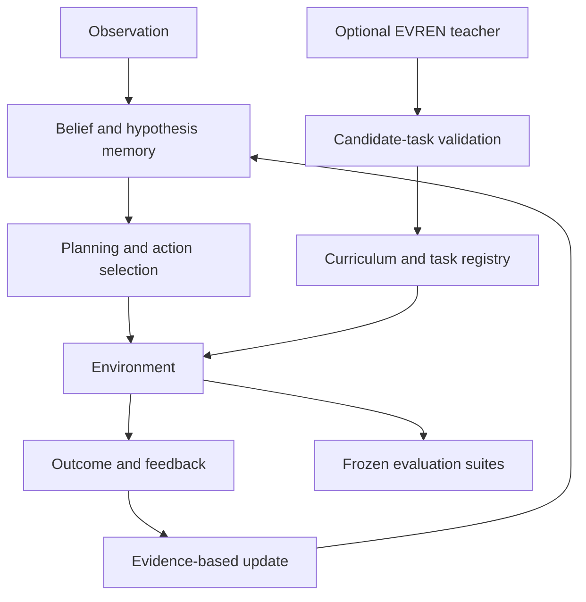

<div align="center">


# 🐦‍⬛ METARGON

**A crow-inspired research project exploring how compact agents learn hidden rules, remember evidence, plan actions, and adapt when the environment changes.**

[](#research-status)
[](#quick-start)
[](#architecture)
[](#license)
[](#research-principles)

**[Overview](#why-metargon) · [The story so far](#the-story-so-far) · [Architecture](#architecture) · [Experiments](#experimental-results) · [Quick start](#quick-start) · [Roadmap](#research-roadmap)**

</div>

---

## Why METARGON?

> **Intelligence is not just predicting a result. It is adapting when the world changes.**

Crows inspired the question, not the implementation: **Can a small artificial agent discover what matters, test hypotheses through action, and revise its behavior when previously useful rules stop working?**

METARGON studies that question with **bounded memory, explicit hypotheses, action planning, structured feedback, and falsifiable evaluations**. The project prioritizes transparent mechanisms and reproducible experiments over impressive-sounding claims.

It is **not** a crow-brain simulation, a foundation model, or a demonstrated AGI system.

---

## The story so far

The project grew from a series of small, falsifiable experiments. Each version asks a sharper question and keeps the full history for provenance.

### CORVID v0.1–v0.7 — early questions (historical)

Under its original name **CORVID**, the project built a sequence of bounded-memory experiments:

| Version | Research question |
|:---|---|
| v0.1 | Active perception: when is an extra observation worth its cost? |
| v0.2 | Selective attention and bounded working memory |
| v0.3 | Active causal probing under sparse, delayed feedback |
| v0.4 | Learned sensor reliability without quality labels |
| v0.5 | Sparse and delayed feedback with verified outcomes |
| v0.6 | Bounded verified-feedback memory for diagnostics |
| v0.7 | Lightweight predictive world models |

These experiments are preserved under their original filenames in `python/`, `rust/` and `docs/`.

### METARGON v0.8 — Learning a Changing World

The project was renamed **METARGON** at v0.8, which introduced an independently specified **stateful five-position workshop**: a key, a switch, a gate whose hidden mechanism can change mid-run, and noisy outcomes.

- **Headline result (negative):** the more complex surprise-adaptive controller **underperformed a strong fixed-hazard Bayesian baseline** by 3.56 percentage points under a tight action budget (85.24% vs 88.79%).
- Full preservation: `docs/RESEARCH_V08.md`, `results/stateful_transfer_30seeds.json`.

### METARGON v0.9 — Compositional World Models & Out-of-Distribution Transfer

v0.9 asks whether a resource-constrained agent can **learn reusable object–action–outcome relationships** and apply them in previously unseen configurations — without being given the hidden wiring.

- **Independent environment:** the "Mechanism Lab" — a 7×5 grid with two movable objects, two pressure plates, two switches, two door barriers, optional delayed effects, and a noisy observation channel. All configurations are verified solvable; training/validation/held-out test pools are disjoint.
- **Compositional causal memory:** bounded hypotheses with an explicit hypothesis → predicted → verified → contradicted lifecycle and deterministic eviction (`python/compositional_memory.py`, `rust/src/v09.rs`).
- **Adaptive bounded planner:** retrieves hypotheses, probes interventions, protects load-bearing atoms, and follows plans until invalidated by a door event (`python/metargon_v09.py`).
- **Strong comparisons:** random, episodic memory, tabular Q-learning, a model-based Bayesian particle-filter planner, and a labeled privileged oracle excluded from deployable rankings.
- **Headline result (negative):** METARGON clearly beats model-free baselines and transfers mechanism knowledge to held-out configurations, **but does not outperform the family-knowing Bayesian planner** (see the results table below).

### Academy v0.1 + EVREN teacher integration (development)

A separate development layer adds a **student/curriculum system** and an **optional AI-assisted task-generation teacher** (EVREN): the teacher proposes *tasks*, not privileged answers; candidates must pass validation, solvability, duplicate, and contamination checks before entering training.

- Academy v0.1 and EVREN are **development-stage work based on local agent reports**; their results are not yet independently verified.
- See `academy/`, `rust_academy/`, `configs/academy_v01.toml`, `docs/ACADEMY_*`, `docs/EVREN_*`.

---

## Experimental results

### v0.9 — mechanism lab (8 paired seeds × 100 episodes × 7 conditions)

| Condition | METARGON | Bayes | Random | Oracle |
|---|---:|---:|---:|---:|
| stable | 35.1% | 77.5% | 0.3% | 100.0% |
| shift | 46.4% | 80.6% | 0.6% | 100.0% |
| rapid_shift | 40.8% | 76.9% | 0.5% | 91.3% |
| iid | 53.6% | 79.0% | 0.4% | 78.9% |
| novel (held-out) | 31.3% | 78.5% | 0.6% | 93.8% |
| noisy_obs | 33.8% | 73.1% | 0.3% | 98.4% |
| tight_budget | 45.0% | 64.9% | 0.0% | 100.0% |

METARGON clearly beats model-free baselines (random/episodic/Q-learning ~0–1%) and transfers mechanism knowledge to unseen configurations, **but does not outperform the strong model-based Bayesian planner** (given the declarative family). This is a negative result for closing the gap to a family-knowing model via hypothesis composition alone. Full table, bootstrap intervals and resource measurements: `results/v09/benchmark_table.md`, `docs/RESEARCH_V09.md`.

### v0.8 — preserved historical result (30 matched seeds × 240 episodes, tight budget)

| Policy | Success |
|:---|---:|
| Privileged mechanism-aware comparator | 92.88% |
| Fixed-hazard Bayesian baseline | **88.79%** |
| METARGON surprise-adaptive controller | 85.24% |
| Win-stay / lose-switch | 85.24% |
| Random first mechanism | 49.24% |

**Negative result worth keeping:** in this condition, the more complex METARGON controller **underperformed the Bayesian baseline by 3.56 percentage points**. The v0.8 study does not establish a general advantage for METARGON. Read the full experiment: [`docs/RESEARCH_V08.md`](docs/RESEARCH_V08.md).

### Academy v0.1 — preliminary local results (agent-reported, not independently rerun)

**Held-out test:** 6 seeds × 40 episodes per policy.

| Policy | Held-out test success | OOD success |
|:---|---:|---:|
| Privileged oracle | 100.0% | 100.0% |
| **METARGON** | **50.0%** | **50.0%** |
| Model-based Bayesian baseline | 27.5% | 20.8% |
| Q-learning | 23.3% | 0.0% |
| Random | 3.3% | 1.3% |

> **Different experimental worlds, different protocols:** v0.8, v0.9 and Academy v0.1 percentages are **not directly comparable**. No measurements here establish real-world robotics performance, AGI, or physical energy savings.

---

## Architecture



**Two distinct layers:** the student acts and learns from environment feedback; the optional teacher proposes *tasks*, not privileged answers. Generated tasks must pass validation, solvability, duplicate checks, and evaluation-contamination safeguards before they can enter training.

### Project structure

```text
python/                  Historical experiments, v0.8 workshop, v0.9 lab and benchmark
rust/                    Bounded Rust research components (v0.2–v0.9 kernels)
docs/                    Research protocols, results, and limitations
results/                 Recorded experimental artifacts (v0.1–v0.9)

academy/                 Academy v0.1 student, environments, evaluations
academy/evren/           Optional EVREN task-generation integration
configs/                 Experiment configuration
rust_academy/            Bounded Rust kernel for Academy
```

---

## Quick start

Requires **Python 3.11+** and the Python standard library only. The historical and v0.9 suites under `python/` still run on Python 3.10+; the Academy layer requires 3.11+ for its standard-library TOML configuration loader. Run commands from the project root.

### v0.9 — mechanism lab benchmark and tests

```bash
python3 -m unittest discover -s python -v
python3 python/benchmark_v09.py --seeds 8 --episodes 100 --parallel --workers 6 --no-mem --json results/v09/summary.json
python3 python/v09_postprocess.py results/v09/summary.json
```

Rust research kernel (crate `metargon-core` v0.9.0, `#![forbid(unsafe_code)]`):

```bash
cd rust
cargo +1.88.0 test
```

### v0.8 — historical workshop demo

```bash
python3 python/metargon_demo.py
python3 -m unittest discover -s python -v
```

For the original recorded experiment:

```bash
python3 python/metargon_world.py --seeds 30 --episodes 240 --json results/stateful_transfer_30seeds.json
```

### Academy v0.1 (development)

```bash
python -m unittest discover -s academy/tests
python -m academy.cli.main smoke
python -m academy.cli.main train
python -m academy.cli.main eval
python -m academy.cli.main ood
```

Optional EVREN teacher integration (requires a locally configured `EVREN_API_KEY`; never commit secrets):

```bash
python -m academy.cli.main evren-smoke
python -m academy.cli.main evren-pilot
python -m academy.cli.main evren-status
```

EVREN curriculum research v0.2 (offline by construction — zero API calls):

```bash
# diagnosis of the v0.1 null result (uses saved policies when present)
python -m academy.cli.main evren-diagnose

# matched-budget adaptive-curriculum comparison (5 conditions)
python -m academy.cli.main evren-curriculum

# quick sanity run (2 conditions, 16 episodes)
python -m academy.cli.main evren-curriculum --quick
```

See `docs/EVREN_CURRICULUM_V02.md` for the scientific protocol and
measured results.

---

## Research principles

- **No privileged-information leakage.** Student-visible observations are separated from simulator internals.
- **Baseline first.** Compare against random, simple heuristics, Bayesian models, and appropriate ablations.
- **Reproducible by design.** Preserve seeds, configurations, checkpoints, and experimental artifacts. Academy runs are deterministic under a fixed `PYTHONHASHSEED`; summary metrics reproduce across hash seeds, while internal hypothesis bookkeeping details may vary.
- **Negative results are results.** A neutral or failed mechanism is documented rather than hidden.
- **Honest efficiency claims.** CPU-only experiments do not prove physical energy efficiency.
- **Modest biological analogy.** Crow behavior motivates research questions; biological equivalence is not claimed.

## Research roadmap

- [x] Preserve earlier CORVID experiments and research history
- [x] Build a stateful hidden-rule workshop (v0.8)
- [x] Build an independent compositional-mechanism environment (v0.9)
- [x] Implement Academy v0.1 and local baseline studies *(reported; integration in progress)*
- [x] Implement optional EVREN candidate-task pipeline *(reported; online validation pending)*
- [ ] Independently verify the integrated Academy results
- [ ] Demonstrate measurable gains from replay and teacher-driven curricula
- [ ] Test transfer to independently designed environments
- [ ] Measure real hardware latency, memory, and energy before making efficiency claims

## Research status

**Exploratory synthetic research.** Results are conditional on specific environments, task distributions, and evaluation protocols. The system does not currently demonstrate human-like intelligence, autonomous general-purpose discovery, biological fidelity, or state-of-the-art performance.

Historical experiment names **CORVID** (v0.1–v0.7) are retained for provenance; the project was renamed **METARGON** at v0.8.

## License

MIT. See the repository's license file for the governing terms.

---

<div align="center">

**Make a hypothesis. Test it. Learn from the outcome.**

*METARGON — Learning a changing world.*

</div>
